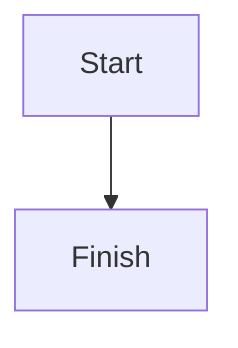

# Savi Notes formatting

Everything a note can contain and how Savi Notes renders it. Notes are
Obsidian-flavoured markdown; `Markdown.js` is the renderer and this file is
its reference. When the renderer learns something new, add it here in the
same change; the `savi-notes` Claude skill reads this file (`savi-notes format`) rather than
listing syntax itself.

The editor's toolbar and Insert menu (`FormatBar.qml`) write the same
syntax, so anything here can also be made from the app.

## Frontmatter

```
---
tags: [savi, sso]
created: 2026-10-17
---
```

`tags` are lowercase, words joined with `-`. Other keys are kept as written
and not rendered. `#tags` in the text also count as the note's tags.

## Text

| Write | Renders as |
|---|---|
| `**bold**` or `__bold__` | bold |
| `*italic*` or `_italic_` | italic |
| `***bold italic***`, `_combined **with** bold_` | both at once |
| `~~struck~~` | strikethrough |
| `==highlighted==` | highlight |
| `` `code` `` | inline code |
| `%%hidden%%` | comment: shown only in the editor, never when reading or in PDFs |
| `#tag` | tag chip; clicking it lists the notes carrying it |
| `\*` | a literal character; any markdown punctuation can be escaped |
| `<br>` | line break inside a paragraph or table cell |

A comment can span lines:

```
%%
Not shown when reading.
%%
```

## Headings

`#` to `######` followed by a space, for levels 1 to 6. The note's file name
is its title, so notes don't repeat it as a level 1 heading.

## Lists and tasks

```
- Bullet (also * or +)
  - Nested by two spaces
1. Numbered (any numbers; 1. 1. 1. counts up)
   1. Nested
- [ ] Open task
- [x] Done task
- [?] Any character in the box counts as done
```

Tasks can be ticked by clicking them when reading. Tags, links and
formatting work inside list items.

## Quotes and callouts

```
> A quote.
> It continues on every line that starts with >.
```

A quote whose first line is `> [!type]` is a callout, with an icon and
color per type:

```
> [!warning] Optional title, which can use **markdown**
> Body text, with any markdown in it.
```

Types (case doesn't matter; anything else falls back to `note`):

| Type | Aliases |
|---|---|
| `note` | |
| `abstract` | `summary`, `tldr` |
| `info` | |
| `todo` | |
| `tip` | `hint`, `important` |
| `success` | `check`, `done` |
| `question` | `help`, `faq` |
| `warning` | `caution`, `attention` |
| `failure` | `fail`, `missing` |
| `danger` | `error` |
| `bug` | |
| `example` | |
| `quote` | `cite` |

`> [!faq]- Title` folds the callout closed until clicked, `> [!faq]+ Title`
folds it but starts open. A callout with only a title line has no body.

## Code

Fenced blocks, with an optional language after the opening fence:

````
```python
print("hello")
```
````

Highlighted languages: JavaScript/TypeScript/JSX/JSON, Java, C/C++/C#, Go,
Rust, PHP, Swift, Kotlin, Dart, Scala, Groovy, QML, Lua, Python, Ruby,
shell (`sh`, `bash`, `zsh`, `fish`, `console`), Dockerfile, INI/TOML/env,
SQL dialects, CSS/SCSS/Less, YAML, Markdown and HTML/XML/SVG/Vue/Blade. Other
languages render as plain monospace. `~~~` fences work too, and lines
indented by four spaces or a tab are a code block.

## Links

| Write | Links to |
|---|---|
| `[[Note name]]` | a note, by title; a note that doesn't exist yet shows dimmer and is created when clicked |
| `[[Note name\|shown text]]` | the same, with other link text (inside a table, escape the pipe: `\|`) |
| `[[Note name#Heading]]` | a heading in a note |
| `[[Note name#^block-id]]` | a block in a note (see block IDs) |
| `[[#Heading]]` | a heading in the same note |
| `[text](https://example.com)` | a web page |
| `https://example.com`, `www.example.com`, `<https://…>` | bare links are clickable |
| `[text](Note%20name.md)` or `[text](<Note name>)` | a note, markdown style |
| `[text](#Heading)` | a heading in the same note |
| `obsidian://open?vault=…&file=Note.md` | the named note |

A block ID is `^id` (letters, digits, `-`) at the end of a paragraph or
list item, after a space: `Some paragraph. ^376b9d`.

## Embeds and images

| Write | Shows |
|---|---|
| `![[Note name]]` | the whole note, inline |
| `![[Note name#Heading]]` | one section, from the heading to the next heading of the same or higher level |
| `![[Note name#^block-id]]` | one block |
| `![[image.png]]` | an image from the vault, found by file name (usually in `Attachments/`) |
| `![[image.png\|300]]` or `![[image.png\|300x200]]` | the image at that width, or width and height |
| `![[file.pdf]]` | any other file, as a link that opens it |
| `` | a web image |
| `` | a web image at 200px wide |

Images never render wider than the reading column. Embedded notes can embed
others, four levels deep.

## Tables

```
| Header | Right aligned | Centered |
| :----- | ------------: | :------: |
| cell   | **markdown**  | [[links]] |
```

The outer pipes are optional. Colons in the divider row align the column.

## Horizontal rule

`---`, `***` or `___` on a line of their own, with a blank line above it.

## Footnotes

```
Here's a footnote.[^1] And a named one.[^note]

[^1]: The footnote text.
[^note]: Can run to more paragraphs,

    indented by four spaces.
```

`^[inline footnote text]` makes a footnote without a separate definition.
Footnotes are numbered in order and listed at the end of the note.

## Math

LaTeX through MathJax: `$e^{i\pi} = -1$` inline, and blocks between `$$`:

```
$$
\begin{vmatrix}a & b\\ c & d\end{vmatrix} = ad - bc
$$
```

A ```` ```math ```` code block is the same as `$$`.

## Diagrams

Mermaid, in a `mermaid` code block:

````

````

Any Mermaid diagram type works (flowchart, sequence, class, state, gantt,
pie, …). They render as images; nodes aren't links.
